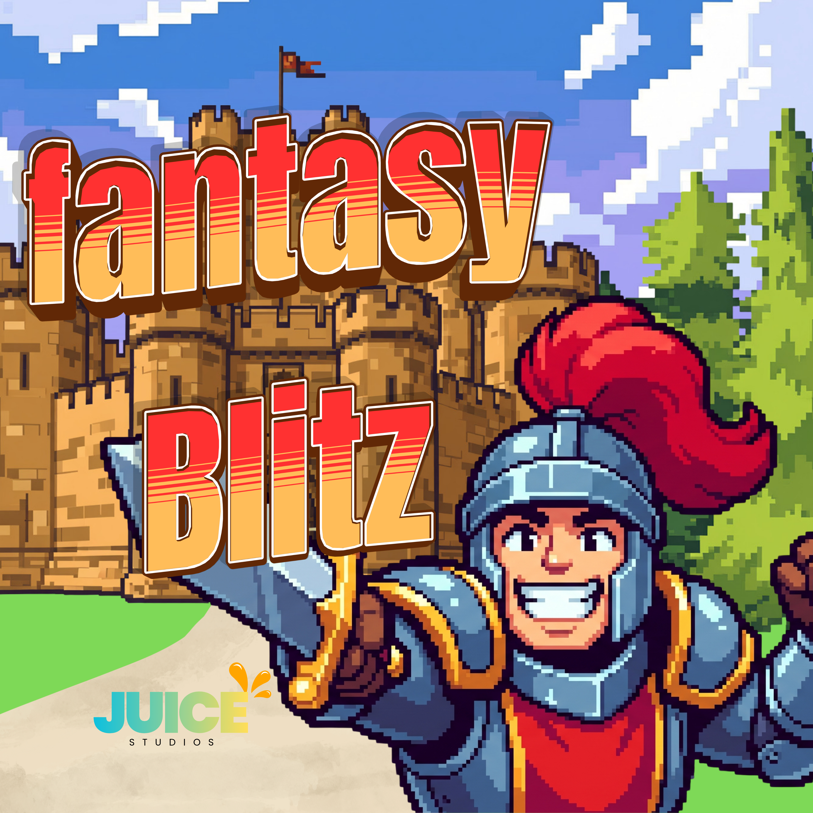
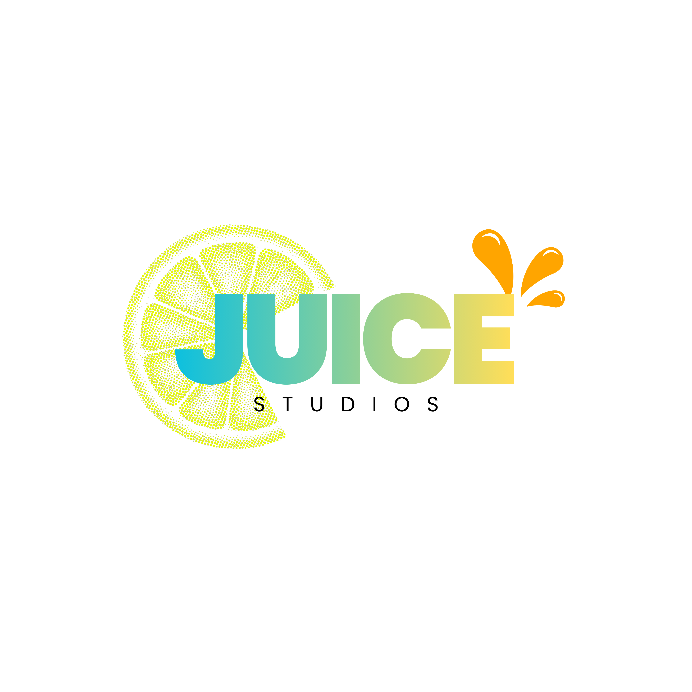

<div align="center">



# 🏰 Fantasy Blitz

**A 2.5-dimensional fantasy tower-defense game.**

*Raise your banners, station your heroes, and hold the castle against the Blitz.*

Made with ❤️ by **Juice Studios**


</div>

---

## 🎬 The Vision

> *The kingdom's last wall still stands. Beyond it, the roads are already crawling.*

**Fantasy Blitz** fuses a 3D overhead battlefield with hand-crafted 2D heroes and monsters — a **2.5D** fantasy tower defense. The horde marches down winding roads toward your **castle**, and you never swing a sword yourself. Instead you **command the field**: earn gold, station heroes along the path, and let them hold the line while every wave grows fiercer.

If the castle falls, so does the realm.

---

## ⚔️ The Core Loop

| | Step | What happens |
|:--:|:--|:--|
| 🪙 | **Earn** | The treasury fills over time, and every fallen foe pays tribute |
| 🃏 | **Choose** | Pick a hero from your command rack |
| 📍 | **Place** | Click a tile to station them along the enemy road |
| 🏹 | **Defend** | Heroes attack automatically as monsters stream toward the castle |
| 🌊 | **Survive** | Clear the wave — the next one arrives larger and stronger |
| 🛡️ | **Hold** | Every monster that reaches the castle costs you. Reach zero and the realm falls |

---

## 🦸 Heroes

Three defenders, three playstyles — pick according to the battlefield.

| Hero | Cost | Range | Damage | Attack Speed | Upgrade Path |
|:--|--:|:--|:--|:--|:--|
| 🗡️ **Knight** | 100 | Short (melee) | **High** | Normal | ➜ **Bleeding** damage over time |
| 🏹 **Archer** | 250 | **Long** | Medium | **Fast** | ➜ Improved damage & range |
| 🔮 **Mage** | 400 | Medium | Lower | Normal | ➜ **Poison**, **Stun**, **Chain Attack** |

> ⚙️ *Prototype note — the current build ships an **Archer / Wizard / Knight** roster at 100 / 150 / 200 gold as stand-ins while the trio above is balanced.*

---

## 👹 Enemies

The horde comes in three flavours, each demanding a different answer.

| Enemy | Behaviour | Castle Damage |
|:--|:--|--:|
| 🎈 **Enchanted Balloon** | Fast; ignores the road and drifts straight for the castle | **10** |
| 🍄 **Mushroom Soldier** | The standard marcher — follows the road at a steady pace | **20** |
| 🪨 **Rolling Boulder** | Slow but heavily armoured; needs sustained, concentrated fire | **30** |

---

## 🌊 Waves & Difficulty

- Monsters arrive in **waves**, with roughly **15–20 seconds of calm** between them to spend gold, upgrade heroes, or fortify the castle.
- Later waves bring **more enemies** and **stronger enemies**.
- **In this prototype:** the enemy count **doubles every wave** (5 ➜ 10 ➜ 20 ➜ 40 …) and difficulty climbs **one stat per wave** — even waves gain **HP**, odd waves gain **speed**.

| Difficulty | Feel |
|:--|:--|
| **Easy** | Fewer waves, fewer enemies |
| **Normal** | The intended experience |
| **Hard** | More waves, tougher hordes |
| **Endless** | Waves never stop — survive as long as you can |

---

## 💰 Gold

Gold is the lifeblood of the defence: it buys heroes, upgrades, and castle levels.

- **Prototype figures:** start with **150**, earn **+10 per kill**, and receive **+2 every 5 seconds**.
- **Selling** a hero refunds **50%** of its price — so every placement is a decision that lasts.

---

## 🏰 The Castle

Your objective and your final refuge. When its **HP reaches 0, the battle is lost**. The castle has no attack of its own, but it can be **upgraded to raise its maximum HP** (+50 per level). It is survivability, not a weapon.

---

## 🗺️ Maps

Multiple outdoor battlefields, each a different puzzle:

- 🏝️ **Island** — precious little space; every tile counts.
- 🌾 **Open Field** — room to experiment with sprawling defences.
- 🌀 **Circular Path** — the road loops long, giving heroes extra chances to strike.

---

## 🎮 What's Playable Today

The repository is a **playable vertical slice** of the game above.

- [x] 3D overhead battlefield with a tile grid and enemy road
- [x] Place towers from build cards (Archer / Wizard / Knight) — no stacking on a tile
- [x] Economy: starting gold, kill rewards, passive income
- [x] Wave system with doubling counts and per-wave difficulty scaling
- [x] Click a tower to inspect it and **sell for 50%**
- [x] HUD: castle lives, wave counter, gold, build rack, inspect panel
- [x] Blinking hover marker that previews the tile under your cursor
- [x] Pause and Defeat screens

---

## 🧱 Built With

| | |
|:--|:--|
| **Engine** | Godot **4.7** |
| **Language** | GDScript |
| **Renderer** | Forward+ |
| **Physics** | Jolt |
| **Rendering API** | Direct3D 12 |

---

## 🕹️ How to Play

1. Launch the project in Godot (**F5**).
2. **Click a hero card** in the bottom-left rack to select it.
3. **Click a tile** on the battlefield to station the hero (tiles already occupied are refused).
4. Hold the line as waves advance — watch your **lives**, **wave**, and **gold** in the top bar.
5. **Click a placed hero** to inspect it; press **Sell** to reclaim 50% of its cost.
6. Press the **pause** button any time.

---

## 🗺️ Roadmap

- [ ] Hero **upgrade** system with tiered effects (bleeding, poison, stun, chain)
- [ ] **Castle HP** + castle upgrades
- [ ] All four **difficulty modes**
- [ ] Additional **maps** (Island, Open Field, Circular Path)
- [ ] 2D hero & monster **sprites** rendered in the 3D world (full 2.5D look)
- [ ] Audio, particles, and hit feedback
- [ ] A balance pass and playtest data
- [ ] Automated tests and CI for the gameplay systems

---

## 📁 Project Structure

```
fantasy-blitz/
├── maps/              # Battlefields, tiles, cameras, level logic
│   ├── playablemaps/  # test.tscn, prototype scene + level scripts
│   ├── TILES/         # Modular 3D tile pieces
│   └── scripts for maps/
├── mobs/              # Enemies: mushroom, balloon, boulder
├── tower/             # Heroes (archer, wizard, knight) + projectiles
├── UI/                # HUD, pause/defeat/title screens, build cards
├── resourceScenes/    # Marker, castle, water, shared props
├── menu/              # Main menu scenes
└── assets/            # Models, cards, icons, art
```

---

<div align="center">



*Design taken from "Fantasy Blitz — A 2.5-Dimensional Tower Defense Game" (Soft Eng doc).*

**Hold the castle. Earn your gold. Survive the Blitz.**

</div>
